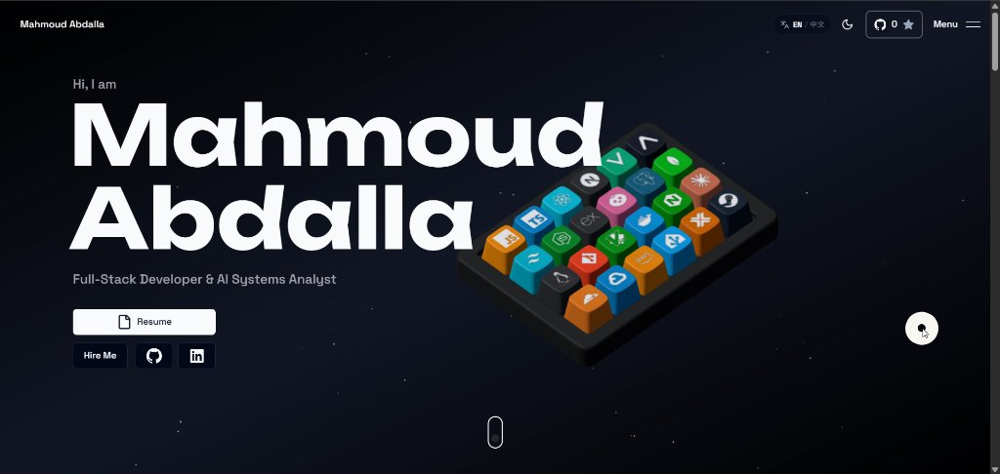

<div align="center">

# 🚀 Mahmoud Abdalla — 3D Portfolio

**Full-Stack Developer & AI Systems Analyst**  
🎓 Computer Science Student at Jinan University | 🇪🇬 From Egypt | 📍 Based in Guangzhou, China

A developer portfolio you can actually play with. Press keys on a 3D keyboard, watch other visitors' cursors fly by, and chat with whoever's online.

### [✨ Live Demo → mahmoudabdalla.vercel.app](https://mahmoudabdalla.vercel.app)

[](https://github.com/mahmoud-abdalla-eg/personal-3d-website/stargazers)
[](https://github.com/mahmoud-abdalla-eg/personal-3d-website/network/members)
[](LICENSE)
[](https://nextjs.org)

<!-- swap for demo video: drag an .mp4 into the GitHub web editor, paste the user-attachments URL on its own line here -->


</div>

---

## 👤 About Mahmoud Abdalla

- 🎓 **Education:** B.S. Computer Science and Technology at **Jinan University** (暨南大学), Guangzhou, China (Expected Graduation: Jun 2028)
- 🌍 **Background:** Originally from **Egypt** 🇪🇬, currently studying & working in **Guangzhou, China** 🇨🇳
- 💻 **Specialization:** Full-Stack Web Development, REST APIs, SSO Integration, UI/UX Design, and AI-assisted Engineering
- 🌐 **Portfolio Website:** [https://mahmoudabdalla.vercel.app](https://mahmoudabdalla.vercel.app)
- 📧 **Email:** [Mahmouddesign01@gmail.com](mailto:Mahmouddesign01@gmail.com)
- 🐙 **GitHub:** [@mahmoud-abdalla-eg](https://github.com/mahmoud-abdalla-eg)
- 💼 **LinkedIn:** [mahmoud-abdalla-eg](https://www.linkedin.com/in/mahmoud-abdalla-eg/)
- 💬 **WeChat ID:** Mahmoud-Ahmed995

---

## ✨ Features

- **Interactive 3D Keyboard** — Programmatically generated Chibi keyboard where each keycap represents a skill, revealing titles and descriptions on hover/press. Try colors, logos, and layouts in the [Chibi keycap customizer](https://chibi.nareshkhatri.dev/demo/keycaps).
- **Live Multiplayer** — See other visitors' cursors in realtime, who's online, and chat with them ([details](#-realtime-features-optional))
- **Buttery Animations** — GSAP + Framer Motion powered scroll, hover, and reveal animations
- **Space Theme** — Floating particles on a dark canvas for a cosmic vibe
- **Easter Eggs** — Open DevTools and follow the clues 🐱
- **Light & Dark Mode** — Full theme support with cheeky disclaimer toasts
- **Responsive** — Works across all screen sizes
- **Contact Form** — Email delivery via Resend
- **Analytics** _(optional)_ — Umami analytics integration

## 🛠️ Tech Stack

| Layer | Technologies |
|---|---|
| **Framework** | Next.js 16.2.2, React 19.2.4, TypeScript 5.9 |
| **Styling** | Tailwind CSS 3.4.1, Shadcn UI, Aceternity UI |
| **Animation** | GSAP 3.12.5, Motion 12.23 (Framer Motion) |
| **3D** | Three.js 0.185.1, React Three Fiber 9.8.1, @chibi3d/runtime 0.5.0 |
| **Email** | Resend 4.0.0 |
| **Misc** | Lenis 1.1.6 (smooth scroll), Zod 3.23.8, next-themes 0.4.6 |

---

## 🚀 Getting Started

### Prerequisites

- Node.js 20.9+ for Next.js 16
- npm 10+ (included with Node.js LTS)

### Installation

1. **Clone the repository:**

    ```bash
    git clone https://github.com/mahmoud-abdalla-eg/personal-3d-website.git
    cd personal-3d-website
    ```

2. **Install dependencies:**

    ```bash
    npm install
    ```

3. **Set up environment variables:**

    Copy `.env.example` to `.env.local` and fill in the values:

    ```bash
    cp .env.example .env.local
    ```

    | Variable | Required | Description |
    |---|---|---|
    | `RESEND_API_KEY` | Yes | API key from [Resend](https://resend.com) for the contact form |
    | `NEXT_PUBLIC_WS_URL` | No | WebSocket server URL for realtime features (cursors, chat, presence) |
    | `UMAMI_DOMAIN` | No | Umami analytics script URL |
    | `UMAMI_SITE_ID` | No | Umami website ID |

4. **Run the development server:**

    ```bash
    npm run dev
    ```

5. Open [http://localhost:3000](http://localhost:3000) and see the magic ✨

---

## Code checks

Run these before opening a pull request:

```bash
npm run lint
npm run typecheck
```

Next.js 16 no longer runs lint during builds. The ESLint CLI uses `eslint.config.mjs`. New React Compiler diagnostics for refs, immutability, effect state updates, and manual memoization report warnings while existing animation and realtime components are migrated. Hook ordering violations remain errors.

Blog frontmatter requires a title, summary, and `publishedAt` date in `YYYY-MM-DD` format. Optional fields are `image`, `author`, and a list of `tags`. Invalid frontmatter raises a content error; unknown blog slugs return a 404.

Files under `public/assets` can be replaced at the same URL and cache for one hour before revalidation. Next.js content-hashed static assets retain immutable caching.

---

## 🎨 Personal Configuration

All personal info is centralized in [`src/data/config.ts`](src/data/config.ts). Edit this file to customize your info:

```ts
const config: Config = {
  title: "Your Name | Your Title",
  description: {
    long: "Your long description for SEO...",
    short: "Your short description...",
  },
  keywords: ["your", "keywords"],
  author: "Your Name",
  email: "you@example.com",
  site: "https://yoursite.com",

  // for github stars button
  githubUsername: "your-github-username",
  githubRepo: "your-repo-name",

  social: {
    twitter: "https://x.com/you",
    linkedin: "https://linkedin.com/in/you",
    instagram: "https://instagram.com/you",
    facebook: "https://facebook.com/you",
    github: "https://github.com/you",
  },
};
```

Other files to customize:

| File | What to change |
|---|---|
| `src/data/projects.tsx` | Projects, screenshots, descriptions, and tech stacks |
| `src/data/constants.ts` | Skills list (name, description, icon) and work experience |
| `public/assets/` | Profile images, OG image, and project screenshots |

---

## ⌨️ Customize the 3D keyboard

Try colors, logos, and layouts in the [Chibi keycap customizer](https://chibi.nareshkhatri.dev/demo/keycaps), then apply your choices to `SKILLS` in [`src/data/constants.ts`](src/data/constants.ts):

- `keyboardColor`: keycap color, such as `"#ff9408"`.
- `keyboardIcon`: copy an SVG URL from [thesvg.org](https://thesvg.org) and paste it here. You can also use a local file under `public/assets/keyboard/logos/`.
- `label` and `shortDescription`: text shown when interacting with a key.
- `shortcut`: optional physical key code, such as `"KeyQ"`. Keep shortcuts unique; defaults follow QWERTY letter order.

The demo accepts logo names too, but `keyboardIcon` needs an image URL or local asset path. Without keyboard overrides, keys use the skill's `color` and `icon`.

Keys follow the order of `SKILLS`. To change the default six columns, pass a second argument to `createKeyboardScene` in [`keyboard-scene.tsx`](src/components/keyboard/keyboard-scene.tsx). Rows adjust automatically to the skill count.

---

## 🔌 Realtime Features (Optional)

The portfolio supports optional realtime features powered by a **separate backend API**:

- 🖱️ **Live cursors** — See other visitors' cursors in realtime
- 👥 **Online presence** — Shows who's currently on the site
- 💬 **Chat** — Live chat between visitors
- **Zombie Survival** with multiplayer and leaderboards on the live site.

These features activate automatically when the `NEXT_PUBLIC_WS_URL` environment variable is set. Without it, the portfolio works perfectly fine as a static site — no realtime features, no backend dependency.

---

## 🤝 Credits & Acknowledgements

- Built using the open-source 3D interactive portfolio template created by [Naresh Khatri](https://github.com/Naresh-Khatri/3d-portfolio).
- Customized and maintained by **[Mahmoud Abdalla](https://github.com/mahmoud-abdalla-eg)**.

---

## 📄 License

This project is open source and available under the [MIT License](LICENSE).
